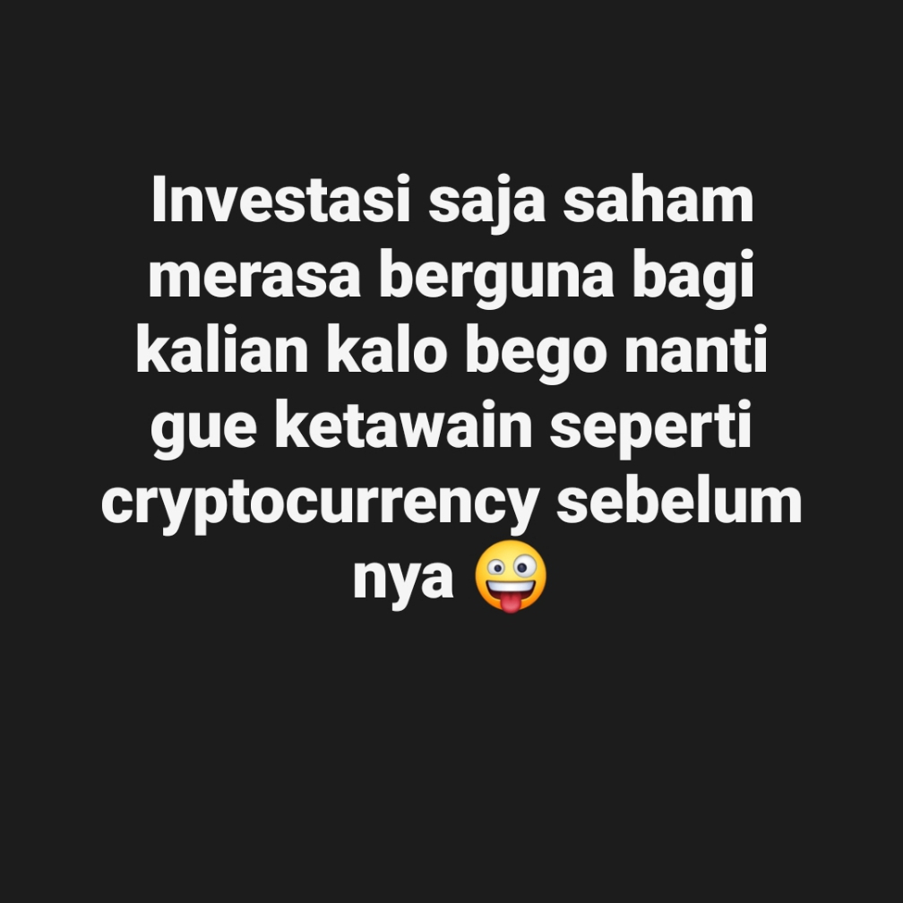
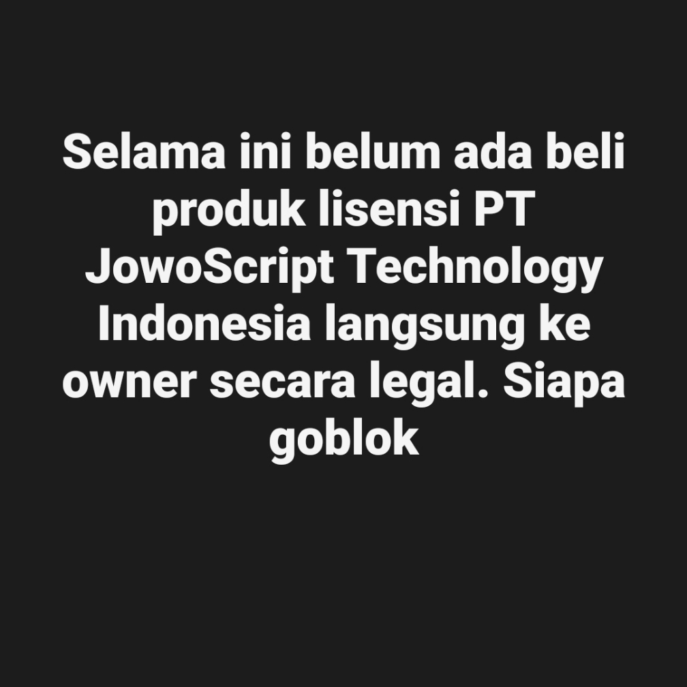
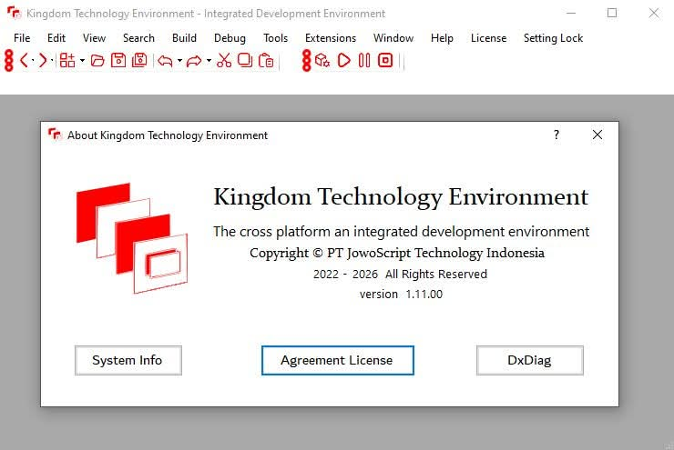
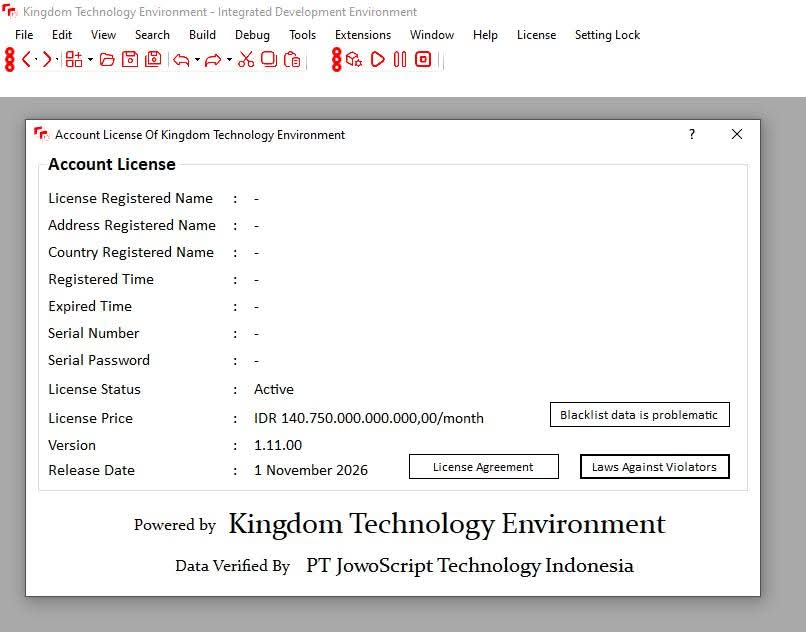

<div align="center">
<a href="https://github.com/JowoScript" target="_self">
</img>
</a>
</div>
<div align="center">
<strong>	
</strong>
<strong>
siapa jadi benalu di dunia kerja selama ini terima gaji dan tunjangan  ? sudah habiskan uang berapa negara selama ini gue tanya di luar sana tapi tidak ada hasilnya ya. Gue tidak terima gaji dan tunjangan selama ini jadi santai kerja sendiri di perusahaan sendiri PT JowoScript Technology Indonesia tidak ada gabungan perusahaan ya siapa jadi benalu gue tanya di pemerintahan dan swasta. Setiap bulan perusahaan atau pemerintah gaji dan tunjangan pegawai saja sudah berapa di luar sana. Siapa jadi benalu di dunia kerja akan terlihat terus setiap waktu di luar sana
	<br><br>
	Siapa habiskan uang pemerintah kalian bukan gue selama ini paham ya lapangan neraka makin luas untuk kalian karena rusaknya agama bukan dari penciptanya melainkan kuman kuman seperti kalian di luar sana berlindung di balik atas nama agama. omongan gue di pegang ya kuman kuman di luar sana
	<br><br>
Dari awal siapa buka lowongan kerja itu pasti pengikut setan untuk habiskan uang selama ini dengan tidak ada hasilnya 
<br><br>
	Orang banyak utang di luar sana apa ada jaminannya masuk surga ? Selevel nabi muhammad saja tidak bisa selamatkan orang punya utang apa lagi level kalian selevel chicken. Bunuh orang masih bisa masuk surga kalo dosanya sudah di hapus. Kalo utang paling berat
	<br>
	butuh tumbal nyawa suka jelek jelekin gue selama ini makin lama makin asik ya apa lagi skill coding di bawah gue jahu. Harus ada bukti fisik mayat nanti waktu pembelian. Kata siapa gue tidak tau orang nya siapa. Pengalaman anak bayi gue intelektual gue mirip pak Suharto ya bedanya umur gue masih muda
	<br><br>
	Introduction from Muhammad Nurcahyo Pratomo the creator new technology capabilities for commercial. Mau di beli atau tidak ngaruh ke gue karena gue kerja sendiri atau tidak nerima gaji selama ini buat produk di perusahaan sendiri tidak pakai uang orang juga, owner bisnis gue juga dan tidak gratisan mau debat kusir dan harga produk mahal itu hak gue pribadi. Siapa jadi sampah di luar sana gue tanya ya. Perusahaan siapa minus terus keuangan nya gue tanya dan siapa jadi pengangguran di luar sana gue tanya setiap tahun lulusan sekolah dan universitas itu nambah naik terus. 
	<br><br>
	Vendor vendor di danai pemerintah selama ini habiskan uang banyak pakai uang rakyat hasil kerjanya apa mereka berguna tidak untuk rakyat dan sekolah atau universitas di danai muridnya sekolah selama ini berguna tidak mereka khususnya pemilik yayasan sekolah atau universitas selama ini berguna tidak selama ini tanpa murid sekolah apa bisa sekolah gaji pegawai dosen dan staffnya ? tidak ya
	<br><br>
Orang di luar sana suka jelek jelekin gue wajib jadi mayat bukti fisik waktu pembelian produk lisensi nantinya itu salah satu syarat utamanya. Kata siapa gue tidak tau orang nya siapa
	<br><br>
	
	<br><br>
	Many School and University in the world wide create many chicken broken the fact before. Makin lama siapa jadi sampah di luar sana dan mau pengangguran meningkat terus gue tidak peduli ya
	<br><br><br><br>
	PT JowoScript Technology Indonesia
	 - breakthrough technology, manufacturing information technology, productive technology and capabilities technology
	<br>
	Alamat kantor usaha
	<br>
	Business office address
	<br>
	JL Larinda Raya Barat No 10, Larangan, Kota Tangerang Banten, Indonesia.
	<br><br>
Aturan gue buat tetap tidak akan berubah emang harus ada mati hina hina gue di luar sana. Mau berbohong saja boleh tapi jangan pernah berbohong sama gue habis langsung.
	<br><br>
	Makin lama makin asik ya kata kata gue fakta di lapangan
	<br><br>
	Muhammad Nurcahyo Pratomo small talk fact
	<br><br>
	My easy talk everything 
	<br>
	
	<br>
	Makin lama makin asik ya siapa jadi sampah pengangguran di luar sana. Paling enak injak kepala orang suka hina hina gue selama ini. Gue pengalaman makin lama siapa jadi tai di luar sana. Gue punya data selama ini hina hina gue di luar sana masih hidup ya.
	<br><br
Setiap tahun lulusan universitas dan sekolah bidang teknologi informasi banyak ya belum tentu bisa dapat kerja apa lagi bersaing denga Ai juga bayar mampus. produk gue juga tidak gratis mampus siapa jadi sampah selama nya
	<br><br>
	Jago finance saja belum tentu kuat hadapi zaman sekarang.
	Soal test masuk kerja itu beda dengan pengalaman di lapangan asli. siapa jadi sampah selama ini itu kalian dulu persulit gue test masuk kerja. gantian gue dirikan perusahaan sendiri siapa jadi sampah pengangguran selamanya itu kalian. Bales dendam gue itu nyata emang punya uang untuk beli produk lisensi perusahaan gue ? mampus bersaing sama Ai kalian jadi sampah selamanya
	<br><br>
	Gaji pegawai dan sewa gedung saja sudah jelas termasuk pengeluaran finance belum lain jual produk belum tentu laku ya hello siapa jadi sampah
	<br><br>
	Biaya sekolah naik setiap tahun belum biaya makan dan uang jajan ya. di baca kata kata gue di bawah
	<br><br>
	Hukum produk teknologi gue buat merucut hukum otoriter. Hidup adalah pilihan ya. Makin lama makin berat ya biaya hidup naik terus ya dan dunia usaha makin berat persaingannya ya. dibaca kata kata gue di bawah ya
	<br><br><br><br>
	
	<br>
	Who Iam ? 
		<br>
	king of cook the cook on cook, play maker of financial, Owner, Director, Law by law, Developer New Programing Technology Product (New shell script, new script, new format extension, new library, new API, new servers, new virtual machine and new kernel) for commercial, Developer Kingdom Technology Environment for commercial, Technology Architecture PT JowoScript Technology Indonesia
	<br><br>
	Rekening or account number of bank only name of Muhammad Nurcahyo Pratomo without that's is fake account number. report fraud outside me, OK?
	<br><br>
	DASAR HUKUM PRODUK PERUSAHAAN PT JowoScript Technology Indonesia di baca ya paham sampai sini. Hukum menganut otoriter gue buat. Enak mana zaman otoriter atau zaman sekarang ? Hukum otoriter gue buat. Tidak suka tidak usah beli di baca dibawahnya ya siapa jadi sampah masyarakat. Mau di beli atau tidak gue kasih tau biaya hidup naik terus ya itu jelas ada hukuman mati loh di produk gue buat kalo mau beli produk lisensi perusahaan gue. Siapa butuh di akhir juga bukan Muhammad Nurcahyo Pratomo or tommy. Makin lama makin asik ya siapa mati di luar sana
	<br><br>
	Didalam persidangan pengadilan saja kalo kalian maki maki hakim saja kalian bisa kena hukuman lebih berat nah seperti itu gue juga kedudukan gue di mata hukum dalam produk gue buat. Di dalam hukum saja jika undang undang baru saja otomatis orang hukum belajar lagi dan undang undang lama itu tidak berlaku. Seperti itu teknologi gue buat sekarang untuk komersial. Hak Azazi Manusia itu tidak berlaku untuk produk perusahaan gue buat karena gue belajar dari pengalaman dimana waktu lamar kerja ikut test kerja tidak ada Hak Azazi Manusia siapa goblok akan menjadi sampah dan akan terlihat sekarang siapa goblok menjadi sampah di luar sana sudah banyak ya silahkan baca rangkaian kata kata gue di bawah ya baik baik pengalaman anak bayi gue. Mau di beli atau tidak gue kasih tau biaya hidup naik terus ya itu jelas ada hukuman mati loh di produk gue buat kalo mau beli produk lisensi perusahaan gue. Siapa butuh di akhir juga bukan Muhammad Nurcahyo Pratomo or tommy. Makin lama makin asik ya siapa mati di luar sana
	<br><br>
	The rules is rules and the law by law
	<br>
	Tidak baca bermasalah sama muhammad nurcahyo pratomo atau tommy the owner (Selama ini masih hidup mereka ya tidak jahu dari teman main sudah terlihat siapa saja dulu salah satunya suka bicara buruk atau fitnah di belakang untuk adu domba dan termasuk daftar nama perusahaan masuk blacklist ya). suhu itu beda mainnya di akhir ya siapa di buru itu kalian kuman kuman. semua itu harus ada bukti mayit kalo mau beli produk. Hidup adalah pilihan ya. Setiap tahun persaingan di dunia bisnis makin berat paham ya dan lulusan sekolah atau universitas itu pasti nambah setiap tahunnya. Kita lihat siapa butuh uang di akhir pasti bunuh bermasalah sama gue di akhir. Tidak perlu tau akhir permainan nya. Gimana ekonomi setiap tahun makin berat ya ✍️😎. Mau kuat kuatan siapa mati di akhir bermasalah sama gue jelas. Ekonomi di Amerika dan Inggris selama ini hanya punya uang saja bisa bertahan disana dan goblok tidak berguna sudah pasti di buang seperti kalianm. Aturan tetap aturan biar mampus selama belum beli aturan gue tambah terus
	<br><br>
	Perusahaan milik gue sendiri biar saja kuman kuman pengangguran pada mati bersaing sama Ai
	<br><br>
	Gue hanya menunggu setiap tahun perusahaan atau pengusaha modal dari hutang atau investasi pada jatuh tempo dan perusahaan go publik tidak ada profitnya pada tutup seperti cryptocurrency
	<br><br>
	Ada hukum an mati di produk gue kalo beli jadi baik baik berisik seperti gue tidak pernah becanda nantinya siapa ekseskusi jelas algojo bukan gue di akhir siapa bego itu kalian. apa zaman dulu pimpinan pernah ekseskusi orang bermasalah ? tidak ya pasti algojo. di dalam blacklist belum di luar blacklist tidak terlihat teman gue bermasalah dulu pasti kerjanya di tempat lain tetap ketahuan di akhir
	<br><br>
	Introduction
</strong>
</div>
</div> 

##### Status pemilik 100% PT JowoScript Technology Indonesia yaitu Muhammad Nurcahyo Pratomo dan statusnya tidak go publik bukan milik orang lain

##### Status keuangan PT JowoScript Technology Indonesia aman sampai akhir zaman tidak memiliki hutang dengan modal sendiri.

##### Did you know PT JowoScript Technology Indonesia is Muhammad Nurcahyo Pratomo this one body of a law.

##### PT JowoScript Technology Indonesia do publication if customer buy (to prevent criminal acts and corruption) this fair enough

###### Purchase list license products customers (Original product has label powered by PT JowoScript Technology Indonesia and license product write by name customers)
<ol>
	<li>Empty</li>
</ol>

### Muhammad Nurcahyo Pratomo Intro Product PT JowoScript Technology Indonesia

##### Do not invest in the Indonesian government or company Indonesia until you have license products from the company PT Jowoscript. Tehnology Indonesia 

##### Perusahaan go publik pailit jatuh tempo kepada investor wajib bayar hutang yaitu modal dari investor. Beda kalo perusahaan sendiri tidak go publik dan modal sendiri. itu sudah aturan dari dulu. 

###### Original product has label powered by PT JowoScript Technology Indonesia. 

#### Purchases of licensed products must be paid in full without debt or credit di baca ya kalo goblok
</img>
	 </img>
### Muhammad Nurcahyo Pratomo Intro Product PT JowoScript Technology Indonesia

### selama pemerintah belum beli produk gue ya siapa goblok dan pintar. semakin lama semakin asik ya aturan syarat pembelian produk gue buat tetap. persaingan makin berat siapa goblok dan pintar

### cara menghukum orang orang goblok jangan di manja jangan buka lowongan kerja biar goblok pada mikir sendiri buka usaha sendiri gimana susah apa gampang ya di akhir jadi apa gue tanya bisa di lihat kalo bukan jadi penjilat ya atau gibah doang selama ini ya

#### Original product has label powered by PT JowoScript Technology Indonesia. Kalo miskin tidak punya uang nonton saja kalian ya di baca harganya ya dan status gue apa di perusahaan PT JowoScript Technology Indonesia ya baik baik kalian banyak gaya sama gue selama ini

</img>

### Kingdom Technology Environment Support Capabilities Technology with license business with Original product has label powered by PT JowoScript Technology Indonesia :
<div align="justify">
<ol>
	<li>Assembly Programming Language free license</li>
	<li>Cobol Programming Language free license</li>
	<li>JowoScript Programming Language no free license this part of products</li>
		<li>Jowo Kingdom Programming Language no free license this part of products</li>
	<li>Jowo Style Sheets Programing Language no free license this part of products</li>
	<li>Cascading Style Sheets Programing Language free license</li>
		<li>JHTML Programming Language no free license this part of products</li>
		<li>HTML Programming Language free license</li>
		<li>JML Programming Language no free license this part of products</li>
		<li>XML Programming Language free license</li>
		<li>JON Programming Language no free license this part of product</li>
		<li>JSON Programming Language free license</li>
		<li>Jowo Query Language or JQL Programming Language no free license this part of products</li>
		<li>SQL Programming Language free license</li>
	<li>PHP Programming Language free license
	</li>
	<li>JavaScript Programming Language Free license</li>
		<li>C and C++ Programming Language Free license</Li>
		<li>C# Programming Language Free License</li>
	<li>Chy and Chy++ Programming Language no free license this part of products</li>
</ol>
		</div>
#### Who Muhammad Nurcahyo Pratomo
<div>
	<ul>
		<li>Mau di beli atau tidak ngaruh ke gue karena gue kerja sendiri selama ini buat produk di perusahaan sendiri tidak pakai uang orang juga, tidak punya utang karena modal sendiri, owner bisnis gue juga dan tidak gratisan mau debat kusir.</li>
		<li>Orang di luar sana suka jelek jelekin gue wajib mati jadi mayat bukti fisik waktu pembelian produk lisensi nantinya itu salah satu syarat utamanya</li>
		<li>Orang bermasalah sama gue biar pada mati dulu dengan bukti mayat. makin lama siapa rugi bukan gue. Gue tidak perlu adab untuk bersih bersih kuman dan hewan</li>
		<li>Makin lama makin asik ya kuman kuman pengangguran di luar sana biar pada mati tidak berguna</li>
		<li>Dulu gue nawarin diri baik baik kerja dengan gaji dan tunjangan kecil banyak tingkah kalian masih di danai pemerintah dan investor. Sekarang siapa jadi sampah di dunia kerja seterusnya. Tetap santai gue bukan orang pelupa ya</li>
		<li>Mau berhitung perhitungan gue lebih besar ya</li>
		<li>Lebih bego dari gue di kasih makan terus oleh negara ya nonton saja kalian netizen. Anggota dewan, menteri, komisaris, pejabat, jendral berbintang gaji dan tunjangan besar banyak ya belum fasilitas negara mereka dapat selama ini</li>
		<li>Tidak punya sopan santun sama gue selama ini masuk blacklist produk perusahaan gue. my easy talk</li>
		<li>Gue kalo bukan owner perusahaan mana berani blacklist perusahaan atau instansi. Paham sampai sini kalian</li>
		<li>Selama belum beli ya nonton saja kalian judul saja bales dendam sampai kiamat gue tetap PT JowoScript Technology Indonesia</li>
		<li>Gue tambahin lagi aturan baru kalo mau beli lisensi produk perusahaan gue wajib data sumber daya manusia wajib gue periksa siapa tau ada orang bermasalah sama gue. Kalo jadi pengangguran bisa apa dan kerja apa mereka atau usaha apa mereka</li>
		<li>Gue juga lebih paham politik, hukum dan ekonomi bukan hanya teknologi informasi saja ya baik baik sok pintar dari gue</li>
		<li>Do not invest in the Indonesian government or company Indonesia until you have license products from the company PT Jowoscript. Tehnology Indonesia</li>
		<li>selama ini belum ada berani bicara langsung ke gue siapa  pengecut selama ini bukan gue ya dan gue boss di perusahaan sendiri selama ini</li>
		<li>Gue sudah pernah rasain mengalamin sendiri di dunia kerja dari di pecat, di buli, di maki maki, lembur tidak dapat uang lembur. beda level ya pengalaman di dunia kerjanya</li>
		<li>Orang lebih goblok dari gue hanya bisa jadi provokator dan buat kerusuhan saja selama ini gue tau. Fakta ya makin lama makin asik ya biar mampus kalian jadi pengangguran dan tidak produktif</li>
		<li>It makes no difference to me who the president is, because I’m a company owner. Recent graduates who are unemployed—the people watching this—can't use PT JowoScript Technology Indonesia company's product features</li>
		<li>Apa orang orang fasih dulu persulit gue lupa apa dengan perbuatannya dan memutar balikan kata kata</li>
		<li>Di danai pemerintah atau investor selama ini hasil kerjanya apa gue tanya karena goblok dan pintar akan terlihat terus ya</li>
		<li>Gue tidak buka lowongan kerja selama ini siapa bego gue tanya hahahaha</li>
		<li>Gue bekerja sendiri selama ini di perusahaan sendiri di PT JowoScript Technology Indonesia</li>
		<li>Siapa mau kerja kalo lebih bego dari gue ya paham kata kata gue orang pintar mana mau kerja sama orang goblok karena sendiri saja mampu buat produk sendiri ya dan perusahaan milik sendiri dan produk jadi ya hasilnya</li>
		<li>Semakin gue di maki maki lewat jeduk jeduk semakin hancur kalian percaya hukum alam tidak kalian ?</li>
		<li>Selama masih hidup teman gue bermasalah sama gue dulu tidak bisa beli produk ya. ini syarat mutlak pembelian produk. semakin lama semakin asik ya</li>
		<li>Bangun produk selama ini tidak pakai uang pemerintah dan investor ya. Tidak gratisan biar mampus siapa goblok</li>
		<li>Gue tidak numpang biaya hidup seperti kalian selama ini tidak nerima gaji dan tunjangan dari pemerintah atau swasta ya.</li>
		<li>Tidak ada setir gue ya selama ini karena benar pintar akan terlihat</li>
		<li>Beli produk gue wajib tunduk hukum gue buat ya di baca ya di bawah itu aturannya</li>
		<li>Kalo saingan gue pengangguran dan pensiunan biar nonton terus selama belum beli ya</li>
		<li>Orang pintar bicara berisik itu beda ya dengan orang goblok ya ✍️📚</li>
		<li>Siapa sudah masuk blacklist gue otomatis perusahaan or istansi mereka akan gue banned secara permanen di produk gue buat baik itu domain name dan localhost apa gue pernah becanda ? tidak pernah ya</li>
		<li>Gue kalo bego tidak mungkin berani sendiri dari awal buat produk sampai sekarang dan tanpa backing an seperti kalian itu fakta ya. Karena pengecut dan punya nyali beda kelas ya. Mampus bego bego di dunia kerja dan dunia usaha ya</li>
		<li>Semua test ujian itu sudah pernah gue coba dari ujian tertulis dan berbasis komputer gantian siapa goblok seterusnya tidak gratis produk perusahaan gue dan terbukti sampai sekarang tidak gratis kalian nonton terus</li>
		<li>Olah raga orang pintar seperti gue jadi tukang bangunan badan gerak semua kalo bosen coding bukan tukang ojek atau olah raga gym ya tidak butuh keahlian kecuali gengsi boleh kalian pilih olah raga gym contoh angkat semen 1 sak itu berat 50 KG dan angkat ember biasa 2 kg itu pasti. tukang bangunan butuh keahlian contoh aduk semen, cat ruang an, plester retakan, manjat genteng, pembagian arus listrik pakai sekring MCB (Miniature Circuit Breaker) wajib, instalasi listrik dan sebagainya</li>
		<li>Orang netral dan pro Muhammad Nurcahyo Pratomo berhak boleh blacklist orang bermasalah sama Muhammad Nurcahyo Pratomo untuk tumbal nantinya mereka selama ini nyerang gue secara berkelompok juga lewat medsos menggunakan akun palsu tapi mereka bodoh di akhir. semakin lama siapa di butuhkan dan siapa mati</li>
		<li>Harga lisensi mahal kenapa dan uang segitu banyak untuk apa nantinya oleh Muhammad Nurcahyo Pratomo jelas M Nurcahyo Pratomo lebih paham perputaran ekonomi dari pada orang bergelar doktor ekonomi dan Professor Ekonomi. Selama belum beli ya siapa kena tekanan bukan Muhammad Nurcahyo Pratomo</li>
		<li>Perusahaan minta di danai duluan belum tentu beli produk PT JowoScript Technology Indonesia jadi kita lihat semakin lama siapa pailit bayar hutang</li>
		<li>Mau mata uang asing naik atau turun bukan urusan Muhammad Nurcahyo Pratomo ya dan bukan kerjaan Muhammad Nurcahyo Pratomo juga ya. Siapa kena tekan selama ini orang bermasalah sama Muhammad Nurcahyo Pratomo mereka jelas akan mati sendiri atau berkelompok di akhir. Siapa goblok dan pintar ya</li>
			<li>Pemerintah jika mau beli produk wajib ikutin aturan Muhammad Nurcahyo Pratomo tidak suka ya tidak usah beli gampang kan dan aturan di buat oleh Muhammad Nurcahyo Pratomo tidak bisa di ganggu gugat oleh pihak manapun baik itu konstitusi pemerintah dan parlementer nya</li>
		<li>Apa efek di masa depan jika kena blacklist dari Muhammad Nurcahyo Pratomo jelas ada ya satu mereka tidak akan berkembang dalam teknologi informasi apapun itu kedepannya, kedua mereka akan berputar disitu saja dalam inovasi kreatif, ketiga akan tertinggal oleh perubahan besar teknologi informasi dan seterusnya. Sedangkan di masa sekarang semua serba digital di dalamnya butuh teknologi informasi</li>
		<li>Muhammad Nurcahyo Pratomo punya kekuasaan penuh blacklist instansi pemerintah, rumah sakit pemerintah atau swasta, perusahaan milik negara, perusahaan go publik, yayasan sekolah atau universitas milik swasta dan sekolah atau universitas milik pemerintah dalam produk PT JowoScript Technology Indonesia</li>
		<li>Biaya sekolah dan universitas dari dulu naik dari zaman gue sekolah juga begituh terus biarkan saja tidak sekolah biar makin goblok. Produk gue buat bisa dirikan sekolah sendiri tidak gratis emang mereka yayasan doang bisa. Sekolah Informatika dan universitas semua menggunakan gratisan jadi beda level sama produk gue buat tidak gratis</li>
		<li>Semakin lama akan terlihat terus siapa goblok di dunia kerja dan perusahaan mana tidak berguna akan bermunculan terus kedepannya. Lulusan sekolah setiap tahun nambah selama belum beli ya nonton juga mereka</li>
		<li>
			<b>Ownership company, directorship company, Software Architecture, Software Engineer and Software Developer at PT JowoScript Technology Indonesia</b>
		</li>
		<li>Behind Hard Code Software architecture, Software Engineer and developer in product Kingdom Technology Environment, JowoScript programing language, Jowo Kingdom Machine and more</li>
		<li> Muhammad Nurcahyo Pratomo a part freelance jobs Artificial Intelligence @anonymous not bound by legal contract by systems.
		</li>
		<li>Lihat saja kedepannya perusahaan mana lagi tutup dan gagal bayar karena kalah bersaing waktu akan bicara ya karena minta pendanaan duluan belum tentu hebat ya pegang omongan gue (Muhammad Nurcahyo Pratomo)</li>
		<li>Gue (Muhammad Nurcahyo Pratomo) dulu di persulit test masuk kerja gantian siapapun wajib beli produk gue (Muhammad Nurcahyo Pratomo) siapa tidak berguna akan terlihat terus di dunia kerja ya waktu akan bicara. Siapa kena pecat di dunia kerja akan terlihat terus kedepannya</li>
	</ul>
</div>

### Muhammad Nurcahyo Pratomo Intro Small talk of Law (the law by law)
<div>
	Do not invest in the Indonesian government or company Indonesia until you have purchased products from the company PT Jowoscript. Tehnology Indonesia 
	<br><br>
	I use Indonesian language everyday, so if you are a foreigner who doesn't understand Indonesian language, that's your problem right simple logic.
	foreigner who doesn't understand Indonesian language, that's your problem right simple logic.
	<br><br>
	The free programing language don't have fundamental of law and easy to be hacking like a phishing (developer cloning website without owner permision) or anything the solution is my product deadlock phishing and different my new programming language and powered by PT Jowoscript Technology Indonesia for commerical  (different law and syntax code). The implicit fair the law by law and the legal by legal
	<br><br>
	Hutang indonesia tembus 10 ribu triliun sekarang jadi santai gue pemerintah Indonesia kalo mau beli produk gue wajib tunduk aturan gue buat kalo tidak suka ya tidak usah beli. essy for me
</div>

### Muhammad Nurcahyo Pratomo Intro Deep The Browser History
<div>
	By 2021 Muhammad Nurcahyo Pratomo (Self) created a new programming language for commercial license (NOT FREE PRICE) and make new rules.
	<br><br>
	The free programing language don't have fundamental of law and easy to be crack or anything and different my new programming language and powered by PT Jowoscript Technology Indonesia for commerical (different law and syntax code). The implicit fair the law by law and the legal by legal
</div>

### Blacklist data is problematic with its Muhammad Nurcahyo Pratomo based on name company (This will update in kingdom technology environment, jowoscript, js3, etc), all data will increase over time stay tune. The relations partner will be blacklist too (After i blacklist They black days the future). They never think 10 years or more about technology information 
<div align="justify">
<ol>
	<li>Di dalam blacklist belum di luar blacklist tidak terlihat teman gue bermasalah dulu pasti kerjanya di tempat lain tetap ketahuan di akhir</li>
	<li>Teman gue bermasalah sama gue harus mati dengan bukti mayit nya jika mau beli produk perusahaan gue ya</li>
	<li>Polisi Indonesia masuk blacklist lagi</li>
	<li>Bank BRI lulusan dari Fasilkom Universitas Indonesia pernah bermasalah sama gue hutang uang tidak bayar kelahiran 1985-1986 nama Mega Puspitasari dan Muhammad rizalul haq dan bule lingkaran setan semua mereka must die. Suka main judi online dulu mereka tidak percaya tanya saja orang kenal mereka</li>
	<li>Universitas Budi Luhur dosen bermasalah sama gue dan bermuka dua ada ya siapa kena pecat juga bukan gue ini ya</li>
	<li>Nvidia corporate ada penyusup musuh musuh gue kerja disana orang Indonesia dan Malaysia siapa kena pecat juga bukan gue ini ya</li>
	<li>Meta inc ada penyusup musuh musuh gue kerja disana orang Indonesia dan Malaysia siapa kena pecat juga bukan gue ini ya</li>
	<li>Badan Kepegawaian Negara persulit Muhammad Nurcahyo Pratomo dulu test kerja lewat CAT berbasis komputer dan orang hasil titipan bisa lulus CAT berbasis komputer semua bisa di rekayasa dari dulu ya giliran Muhammad Nurcahyo Pratomo tidak bisa dulu so gantian Muhammad Nurcahyo Pratomo blacklist BKN siapa goblok selama ini. tidak pakai cat komputer bisa lulus jadi pns, polri dan tni dulu banyak. mau bicara adil BKN ?</li>
	<li>Wikipedia delete my name  Muhammad Nurcahyo Pratomo article  and my company PT JowoScript Technology Indonesia article and my products article (proof archive internet) because i write my name article for biography history alone and my product and my company so i can blacklist too wikipedia in my product. this fair right then my product blacklist domain name server permanent for Wikipedia and no matter how expensive Wikipedia domain name thats be zero by me too thats website running in php i know. kenapa gue harus takut sama orang lebih goblok dari gue ya kalian bisa apa gue tanya persaingan makin berat kedepannya. Gimana produk komersial lainnya perusahaan komersial lainnya menampilkan di Wikipedia tidak di hapus ya</li>
	<li>Cryptocurrency</li>
	<li>Holywings Group</li>
	<li>Big bad wolf Indonesia (global) is have problematic with Muhammad Nurcahyo Pratomo before (bullying and intimidation work / buliying saya di waktu kerja pada tahun 2017 di Surabaya) siapa bullying gue dulu waktu kerja di surabaya sampai ngancam gue tembak mati di group wa siapa calon mayat di akhir bukan gue ya dan kenapa gue harus takut sama orang lebih goblok dari gue ya di wa group dulu. Pak Amir suruh buka suara sana saksi hidup dan chat wa group</li>
	<li>Penta Group Indonesia</li>
	<li>Sinergi group Indonesia</li>
	<li>IFS Solusi Integrasi Indonesia (Vina Rivelina) is have problematic with Muhammad Nurcahyo Pratomo before (see point number 22 / mainin gue test masuk kerja | Setiap perusahaan gue datengin pasti gue catat)</li>
	<li>Medco Energi Indonesia is have problematic with Muhammad Nurcahyo Pratomo before (see point number 22 / mainin gue test masuk kerja | Setiap perusahaan gue datengin pasti gue catat)</li>
	<li>MetroData Indonesia is have problematic with Muhammad Nurcahyo Pratomo before (see point number 22 / mainin gue test masuk kerja | Setiap perusahaan gue datengin pasti gue catat) so the relationship with IBM partners is tied up</li>
	<li>Whatever type of cryptocurrency (global) is ilegal currency (case closed)</li>
	<li>Infosys india is have problematic with Muhammad Nurcahyo Pratomo before (see point number 22 / mainin gue lewat test masuk kerja | Setiap perusahaan gue datengin pasti gue catat)</li>
	<li>IBM Indonesia</li>
	<li>MNC Group Indonesia (see point number 22 / mainin gue lewat test masuk kerja | Setiap perusahaan gue datengin pasti gue catat)</li>
	<li>Transcorp (PT Trans Corpora) (see point number 22 / mainin gue lewat test masuk kerja | Semua perusahaan gue datengin pasti gue catat)</li>
	<li>SMK Media Informatika (guru) guru bermasalah sama gue kalo kena pecat jadi pengangguran gampangkan bisa apa guru bermasalah sama gue, bisa berdiri sendiri seperti gue (yang lemah dan kuat akan terlihat ketika sendiri | mainin gue dalam membuat RPP)</li>
	<li>Kementerian Pendidikan Tinggi, Sains, dan Teknologi Indonesia (Dosen Oknum) Dosen bermasalah sama gue kalo kena pecat jadi pengangguran gampangkan bisa apa dosen bermasalah sama gue, bisa berdiri sendiri seperti gue (yang lemah dan kuat akan terlihat ketika sendiri)</li>
	<li>Apapun alesannya test psikotest semua masuk blacklist gue kalian (jurusan psikologi) sudah merugikan banyak jurusan, orang bukan jurusan psikologi di kasih soal test psikotest siapa yang goblok sebenarnya ? Jurusan psikologi di kasih soal jurusan kedokteran bisa jawab tidak atau kasih soal jurusan hukum atau kasih soal jurusan IT. Orang psikologi  paham artinya linier tidak dalam bidang jurusan ? tanya pakar professor di universitas</li>
	<li>Sekolah Al-Hikmah petukangan selatan. music suara siapa di kita gue tidak tau dan siapa goblok selama ini gue tanya</li>
	<li>SMK Yadika 4 ciledug pernah lamar kerja disana gue ya dan siapa goblok selama ini gue tanya</li>
	<li>
SMK Budi Luhur Ciledug pernah lamar kerja disana gue ya dan siapa goblok selama ini gue tanya</li>
</ol>
</div>

### Muhammad Nurcahyo Pratomo Intro Product PT JowoScript Technology Indonesia

#### Original product has label powered by PT JowoScript Technology Indonesia. sesuai judul orang mau nipu gue di akhir mati sendiri. Hobinya ngumpulin uang tapi tidak beli mampus di akhir karena orang goblok sok pintar dari gue itu banyak. Sesuai judul orang sok pinter dari gue di akhir jadi bahan hinaan dan amukan banyak orang. Siapa lagi orang goblok dan dungu suka ngarang cerita lagi. Paham sampai sini

#### Only work in my new programing language (JowoScript and JS3)

</img>
	 
#### Legality Statement Letter of PT JowoScript Technology Indonesia

#### Original product has label powered by PT JowoScript Technology Indonesia. sesuai judul orang mau nipu gue di akhir mati sendiri. Hobinya ngumpulin uang tapi tidak beli mampus di akhir karena orang goblok sok pintar dari gue itu banyak. Sesuai judul orang sok pinter dari gue di akhir jadi bahan hinaan dan amukan banyak orang. Siapa lagi orang goblok dan dungu suka ngarang cerita lagi. Paham sampai sini

</img>

### Muhammad Nurcahyo Pratomo Intro Product PT JowoScript Technology Indonesia

#### Original product has label powered by PT JowoScript Technology Indonesia. sesuai judul orang mau nipu gue di akhir mati sendiri. Hobinya ngumpulin uang tapi tidak beli mampus di akhir karena orang goblok sok pintar dari gue itu banyak. Sesuai judul orang sok pinter dari gue di akhir jadi bahan hinaan dan amukan banyak orang. Siapa lagi orang goblok dan dungu suka ngarang cerita lagi. Paham sampai sini

</img>
	 
### Muhammad Nurcahyo Pratomo Intro Small talk Example Product
<ul>
	<li>Many new method encryption end to end in product</li>
	<li>Many new method decryption end to end in product</li>
	<li>Many new method element in product</li>
	<li>Many new method paradigma in product</li>
	<li>Many new method secret in product</li>
</ul>

### Muhammad Nurcahyo Pratomo Intro Jowo Kingdom Machine or JKM History Small talk
<div>
	I'm alone behind Code alone Jowo Kingdom Machine or JKM until now, Jowo Kingdom Machine or JKM Build first 2024 until now and build with knowledge. Build by end to end encryption biar mampus kalian tidak bisa mencuri. not free product.
</div>

### Muhammad Nurcahyo Pratomo Intro JXML and JHTML History Small talk
<div>
	I'm alone behind Code JXML and JHTML until now, JXML and JHTML Build first 2025 until now and build with knowledge. Build by end to end encryption biar mampus kalian tidak bisa mencuri. not free product.
</div>

### Muhammad Nurcahyo Pratomo Intro Jowo Object Notation History Small talk
<div>
	I'm alone behind Code Jowo Object Notation until now, Jowo Object Notation Build first 2025 until now and build with knowladge. Build by end to end encryption biar mampus kalian tidak bisa mencuri. not free product.
</div>

### Muhammad Nurcahyo Pratomo Intro JowoScript and JS3 History Small talk
<div>
	I'm alone behind Code JowoScript and JS3 until now, JowoScript and JS3 Build first 2021 until now and build with knowladge. Build by end to end encryption biar mampus kalian tidak bisa mencuri. not free product.
</div>

### Muhammad Nurcahyo Pratomo Intro Kingdom Technology Environment History Small talk
<div>
	I'm alone behind Code Kingdom Studio until now, Kingdom Studio Build first 2025 until now and build with knowledge. Then I changed the name to Kingdom Technology Environment in 2026. Build by end to end encryption biar mampus kalian tidak bisa mencuri. not free product.
</div>

### Jaminan Produk (Jika sudah beli)
<ul>
<li>PT JOWOSCRIPT TECHNOLOGY INDONESIA, DAN AFILIASI, PENGECER, DISTRIBUTOR, DAN VENDOR, TIDAK MEMBERIKAN JAMINAN, BAIK TERSURAT MAUPUN TERSIRAT, GARANSI, ATAU KETENTUAN SEHUBUNGAN DENGAN PENGGUNAAN LAYANAN OLEH ANDA. ANDA MEMAHAMI BAHWA ANDA MENANGGUNG RISIKO PENGGUNAAN LAYANAN DAN KAMI MEMBERIKAN LAYANAN "SEBAGAIMANA ADANYA", "DENGAN SEGALA KEKURANGANNYA", DAN "SEBAGAIMANA TERSEDIA". PT JOWOSCRIPT TECHNOLOGY INDONESIA TIDAK MENJAMIN KEAKURATAN ATAU KETEPATAN WAKTU LAYANAN. ANDA MUNGKIN MEMILIKI HAK-HAK TERTENTU MENURUT HUKUM SETEMPAT ANDA. TIDAK ADA SATU BAGIAN PUN DALAM PERSYARATAN INI YANG DIMAKSUDKAN UNTUK MEMENGARUHI HAK TERSEBUT, JIKA MEMANG ADA. ANDA MEMAHAMI BAHWA KOMPUTER DAN SISTEM TELEKOMUNIKASI TIDAK BEBAS DARI KESALAHAN DAN LAYANAN MUNGKIN AKAN SESEKALI TIDAK TERSEDIA. KAMI TIDAK MENJAMIN LAYANAN TIDAK AKAN TERGANGGU, TEPAT WAKTU, AMAN, ATAU BEBAS DARI KESALAHAN ATAU BAHWA HILANGNYA KONTEN TIDAK AKAN TERJADI, ATAU KAMI TIDAK MENJAMIN SAMBUNGAN ATAU TRANSMISI APA PUN DARI JARINGAN KOMPUTER.
</li>
<li>SEJAUH YANG DIIZINKAN OLEH HUKUM SETEMPAT, KAMI MENGECUALIKAN JAMINAN TERSIRAT APA PUN, TERMASUK KELAYAKAN UNTUK DIPERDAGANGKAN, KUALITAS YANG MEMUASKAN, KESESUAIAN UNTUK TUJUAN TERTENTU, KECAKAPAN USAHA, DAN KETIADAAN PELANGGARAN.</li>
</ul>

### Legal Rights of Technology Muhammad Nurcahyo Pratomo and Basic Regulatory Requirements for Registration and Purchase (if you buy and if you don't buy, just watch because the real stuff and fake stuff is different) the real stuff have label powered PT JowoScript Technology Indonesia. Specifically for purchasing licensed products. So whos stupid until now
<div align="justify">
<ol>
	<li>Tidak pernah di pidana atau kasus hukum atau narapidana</li>
	<li>Gue tambahin lagi aturan baru kalo mau beli lisensi produk perusahaan gue wajib data sumber daya manusia wajib gue periksa siapa tau ada orang bermasalah sama gue. Kalo jadi pengangguran bisa apa dan kerja apa mereka atau usaha apa mereka</li>
	<li>Suka berkendara motor atau mobil kenalpot tidak standar atau bising lewat depan rumah tinggal di komplek sekarang termasuk blacklist di produk perusahaan gue ya. Plat no kendaraan kalian gue foto selama ini lewat. Masuk gang perkampungan saja bising kena marah kalian nitizen seenaknya jidatnya siapa tidak punya sopan santun itu kalian nitizen</li>
	<li>Harga sewa produk dibaca perbulan nya ya kalo mau beli waktu sewa habis otomatis terkunci</li>
	<li>Di larang keras Perusahaan pembuat kecerdasan buatan atau artificial intelligence (AI) untuk membuat gambar eksplisit tanpa persetujuan pemilik gambar dalam melakukan pelecehan seksual, kekerasan dan porno merugikan pihak korban dari gambar editan artificial intelligence atau video dari susunan gambar per capture.</li>
	<li>Bermasalah sama gue dekat komplek juga harus mati ya apa lagi teman bermuka dua</li>
	<li>Makin lama makin asik ya pemain vs raja Waktu pembelian Wajib ada bukti mayat bermasalah sama Muhammad Nurcahyo Pratomo baik itu teman bermuka dua dan musuh nya ini berlaku di Indonesia dan Malaysia. Tidak bermasalah sama gue aman dan pro sama Muhammad Nurcahyo Pratomo ya.  Bermasalah sama Muhammad Nurcahyo Pratomo dulu pasti mencla mencle ngomongnya pasti ya</li>
	<li>Status manusia atau orang bukan hewan atau binatang memiliki bebas dari catatan pidana atau berkedudukan sebagai bukan sebagai terpidana</li>
	<li>Trust the god only one name is allah [the bible old not modified, Al-Qur'an, Al-Kitab] and Tidak boleh menyekutukan Allah SWT mau sembahyang atau tidak urusan masing masing individu tidak ada pemaksaan</li>
	<li>Di danai pemerintah atau investor selama ini hasil kerjanya apa gue tanya karena goblok dan pintar akan terlihat terus ya</li>
	<li>Perusahaan pailit wajib bayar hutang kepada pemodal</li>
	<li>Jangan buka lowongan kerja selama belum di beli produk</li>
	<li>Mahkamah Agung sebagai peninjau dan tangan kanannya Muhammad Nurcahyo Pratomo langsung untuk hukum berkelanjutan dan militer bagian ekseskusi jika pemerintah sudah beli selama belum beli ya nonton saja sambil blacklist karena tidak rugi blacklist bermasalah dengan Muhammad Nurcahyo Pratomo</li>
	<li>Aturan Hukum Muhammad Nurcahyo Pratomo tidak bisa di ganggu gugat oleh pihak manapun baik itu pidana, perdata, konsitusi, adat, undang undang, trakta, yurisprudensi  dan sejenisnya. Hukum tetap mutlak di atas apapun itu. the checkmate forever</li>
	<li>Anak umur di bawah 18 tahun wajib kena proses hukum jika melanggar aturan hukum itu resiko orang tuanya jika tidak bisa mendidik anaknya dengan benar. Apa lagi suka tawuran ya nyusahin warga disekitar saja ya dan tidak ada jaminan pembebasan wajib jadi tahanan paling lama 1 tahun kerja sosial wajib, paling cepat 6 bulan dan tanpa di gaji ya. Makan atau minum di tanggung orang tuanya masing masing karena tidak bisa mendidik dengan benar</li>
	<li>Siapa buat music jeduk jeduk dari 2021 sampai sekarang harus mati manusia nya apa di share Facebook Muhammad Nurcahyo Pratomo or tommy script karena merusak mental di sengaja secara berkelompok lewat music jeduk jeduk</li>
	<li>Tidak boleh menyekutukan Allah SWT mau sembahyang atau tidak urusan masing masing tidak ada pemaksaan</li>
	<li>Tidak boleh ada pungutan liar meminta uang untuk kepentingan kelompok organisasi atau pribadi contoh meminta jatah keamananan untuk ruko atau pengusaha, dan seterusnya banyak contoh</li>
	<li>Tidak boleh korupsi dan nepotisme secara tertutup atau terbuka karena merugikan negara</li>
	<li>Sudah pernah punya SIM atau SIM mati untuk Perpanjang Surat Izin Mengemudi wajib gratis seumur hidup berlakunya seperti KTP berlaku seumur hidup tidak ada perpanjangan dan belum pernah punya SIM wajib bayar. Orang punya sim saja kena musib juga ada dari dulu apa bedanya untuk ladang cari uang selama ini padahal sudah di gaji oleh negara selama ini. bikin malu saja. Kenapa KTP buat tidak bayar dari dulu dan KTP tidak perpanjang sekalian 5 tahun sekali wajib bayar juga kalo mau adu argumentasi. Kalo mau nindas rakyat itu mudah ya KTP bayar kelar. SIM mati kena tilang cari uang namanya pemaksaan wajib bayar. Kalo punya SIM hidup ada jaminannya apa selamat orang berkendara di jalan ? tidak ada ya itu kesimpulan selama ini.
	<li><b>It is strictly forbidden to wage war between countries without a clear reason based on the unity of nations and this is also i'm agree</b></li>
	<li>The free programing language don't have fundamental of law and easy to be crack or anything and different my new programming language and powered by PT Jowoscript Technology Indonesia for commerical (different law and syntax code). The implicit fair the law by law and the legal by legal</li>
	<li>My new programming language must use end-to-end encryption and privacy security, return to the rules of Muhammad Nurcahyo Pratomo (law by law) and cannot be sued by any party is a permanent legal form</li>
	<li>If the party members intimidate me then I will be blacklist by the party for no reason whatsoever, return to the rules of Muhammad Nurcahyo Pratomo (the law by law)</li>
	<li>Muhammad Nurcahyo Pratomo is tax-free from the government and invansion, return to the rules of Muhammad Nurcahyo Pratomo (the law by law)</li>
	<li>People who have been to prison are strictly prohibited from using new programming languages ​​and products return to the rules of Muhammad Nurcahyo Pratomo (the law by law)</li>
	<li>Intimidation, whether verbal or otherwise, is strictly prohibited. The incident against Muhammad Nurcahyo Pratomo is a serious offense and could result in a fine of <b>1,000 trillion rupiah</b> return to the rules of Muhammad Nurcahyo Pratomo dan siapa nyuruh buat music akan jadi tersangka utama ya dan sebaliknya jika tidak ada nyuruh buat music siapa akan jadi tersangka utama nya jelas buat music, return to the rules of Muhammad Nurcahyo Pratomo (the law by law) </li>
<li>All types of psychometric test questions should be must eliminated as a requirement for entering the workforce or of kind , return to the rules of Muhammad Nurcahyo Pratomo (the law by law)</li>
<li>The government is strictly prohibited from waging war between countries except to combat gambling sites, narcotics, corruption and the like, return to the rules of Muhammad Nurcahyo Pratomo (the law by law)</li>
<li>Must follow obey the legal policy rules and regulations in force in the country where you live and cannot be contested by any party</li>
<li>Whatever type of cryptocurrency is not allowed forever to buy my products at any time and Only the local currency of your country of residence is allowed to purchase my products. This fair and justice for government (So the local currency government value have more powerful than cryptocurrency)</li>
<li>Sites that contain pornography and immorality are strictly prohibited (Website or app users must be 20+ for adult content movie warnings)</li>
<li>Gambling sites are strictly prohibited,return to the rules of Muhammad Nurcahyo Pratomo (the law by law) and government</li>
<li>Terrorism sites are strictly prohibited,return to the rules of Muhammad Nurcahyo Pratomo (the law by law) and government</li>
<li>User strictly prohibited as an instrument of crime return to the rules of Muhammad Nurcahyo Pratomo (the law by law)</li>
<li>The policy of the intellectual patent by Muhammad Nurcahyo Pratomo cannot be contested by any party, either in the future or now. Both in the form of binary code and inherethin or computed binary intellectual within patent and legal rights of technology creators by Muhammad Nurcahyo Pratomo. Legal Rights of Technology Creators</li>
<li>Muhammad Nurcahyo Pratomo cannot be sued by any party, including the government, if it is detrimental to Muhammad Nurcahyo Pratomo, return to the rules of Muhammad Nurcahyo Pratomo</li>
<li>Muhammad Nurcahyo Pratomo  has the right to blacklist if there are individuals problem for me return to the rules of Muhammad Nurcahyo Pratomo </li>
<li>Muhammad Nurcahyo Pratomo has the right to blacklist government agencies if there are individuals who threaten and make things difficult for me return to the rules of Muhammad Nurcahyo Pratomo</li>
<li>Muhammad Nurcahyo Pratomo has the right to blacklist company agencies if there are individuals who threaten and make things difficult for me,  return to the rules of Muhammad Nurcahyo Pratomo</li>
<li>Muhammad Nurcahyo Pratomo has the right to create global native code and strict code in bytecode form with a valid commercial license in the field of science with new programing language</li>
<li>Whatever type of cryptocurrency is strictly prohibited and into blacklist, return to the rules of Muhammad Nurcahyo Pratomo (the law by law)</li>
<li>Money laundering is strictly prohibited, return to the rules of Muhammad Nurcahyo Pratomo (the law by law) and government</li>
<li>Whatever the type of music and video, everything is regulated in the provision of services for each application and does not violate copyright, return to the rules of Muhammad Nurcahyo Pratomo (the law by law)</li>
<li><b>Minimum age required to be 18 years old in using programming language code and can use good logic algorithms</b> return to the rules of Muhammad Nurcahyo Pratomo (the law by law) </li>
<li>Price tag that has been applied cannot be contested by any party, either in the future or now, return to the rules of Muhammad Nurcahyo Pratomo (the law by law)</li>
<li>Alcohol or intoxicating drinks sites are strictly prohibited, return to the rules of Muhammad Nurcahyo Pratomo (the law by law)</li>
<li>User OR Applications that support drug or narcotics transactions are strictly prohibited (example case study like heroin, cocaine, morphine, opium, etc) return to the rules of Muhammad Nurcahyo Pratomo (the law by law) </li>
<li>Must have a legality flag that is a legal entity return to the rules of Muhammad Nurcahyo Pratomo (the law by law) </li>
<li>It is strictly prohibited for weapons of war such as politics, crime and kindly, return to the rules of Muhammad Nurcahyo Pratomo (the law by law)</li>
<li>Haters, abusers, bullies and two-faced friend (good in front but rotten behind) people from indentiy (Indonesia and Malaysia) are MUST DIE FIRST and there must be EVIDENCE OF THE BODY</li>
<li>The company (Indonesia and Malaysia) that had problems with Muhammad Nurchayo Pratomo was the entrance test and etc before are strictly prohibited from obtaining licenses forever, return to the rules of Muhammad Nurcahyo Pratomo (the law by law)</li>
<li>Friends people (example playmates or school or work) and two-faced friend (good in front but rotten behind) (Indonesia and Malaysia) They can hide from Muhammad Nurcahyo Pratomo but can't be lie in the out and people (Indonesia and Malaysia) who have problems with Muhammad Nurchayo Pratomo are MUST DIE FIRST and there must be EVIDENCE OF THE BODY.  Even if the problematic friend works for a government agency, the same rules apply to that agency. return to the rules of Muhammad Nurcahyo Pratomo (the law by law)</li>
<li>Especially for those who insert sound into music in Disc Jockey (DJ) and the conclusion is that the sound is changed into music to curse and be alone, the perpetrator MUST DIE FIRST and there must be EVIDENCE OF THE BODY if there is a company or government that wants to buy the license. Life is a choice. Rules are rules. If you dare to insult and curse by inserting sound into music, it means you have to dare to take risks. There must be proof of death of the perpetrator who made the music insert all this time. return to the rules of Muhammad Nurcahyo Pratomo (the law by law)</li>
<li>Registered trademark products of PT JowoScript Technology Indonesia return to the rules of Muhammad Nurcahyo Pratomo</li>
<li>Registered trademark logos of PT JowoScript Technology Indonesia return to the rules of Muhammad Nurcahyo Pratomo</li>
</ol>
</div>

### Legal Rights of Technology Creators and The regulatory requirements for purchase license tokens
<div align="justify">
<ol>
	<li>Suka berkendara motor atau mobil kenalpot tidak standar atau bising lewat depan rumah tinggal di komplek sekarang termasuk blacklist di produk perusahaan gue ya. Plat no kendaraan kalian nitizen gue foto selama ini lewat depan rumah</li>
	<li>Makin lama makin asik ya pemain vs raja Waktu pembelian Wajib ada bukti mayat bermasalah sama Muhammad Nurcahyo Pratomo baik itu teman bermuka dua dan musuh nya ini berlaku di Indonesia dan Malaysia. Tidak bermasalah sama gue aman dan pro sama Muhammad Nurcahyo Pratomo ya.  Bermasalah sama Muhammad Nurcahyo Pratomo dulu pasti mencla mencle ngomongnya pasti ya</li>
<li>Must follow and obey basic regulatory requirements in registration license agreement</li>
<li>Payment and purchase of the license is carried out by both parties with witnesses from the technology maker by Muhammad Nurcahyo Pratomo and a lawyer or legal entity</li>
<li>Must have a legality flag that is a legal entity</li>
<li>Must have a domain name server live as your legality flag name masters (example of a live universal domain is *.gov.your name of goverment or any domain)</li>
<li>Technology remains in end to end encryption</li>
<li>Can use Technology features if the license token runs out will not be able to use</li>
<li>Technology can be controlled for localhost or 127.0.0.1 and can be changed choices to your own ip settings</li>
</ol>
</div>

### Legal Rights of Technology Creators and Laws against violators of the Legal Rights of Technology Creators
<div align="justify">
<ol>
<li>Will deal with the laws in force in the country where you live or jail the future</li>
<li>The license product purchaser may choose an appointed attorney who will act to prosecute any existing violations and may not be sued by any party</li>
<li>Gambling The minimum fine for violation is the minimum price of the license purchased cannot be contested by any party, either in the future or now</li>
<li>Case studies on the inability to pay the minimum fine for violations will be submitted to existing laws, both based on the legal basis in force in the country where you live and cannot be challenged by any party</li>
<li>Payment of fines is made by both parties witnessed by the court and and lawyers or prosecutors or legal entities</li>
</ol>
</div>

### Kingdom Technology Environment Support Capabilities Technology with license business with Original product has label powered by PT JowoScript Technology Indonesia :
<div align="justify">
<ol>
	<li>JowoScript Programming Language<</li>
		<li>Jowo Kingdom Programming Language</li>
		<li>JHTML Programming Language</li>
		<li>HTML Programming Language</li>
		<li>JML Programming Language</li>
		<li>XML Programming Language</li>
		<li>JON Programming Language</li>
		<li>JSON Programming Language</li>
		<li>Jowo Query Language or JQL Programming Language</li>
		<li>SQL Programming Language</li>
	<li>PHP Programming Language
	</li>
	<li>JavaScript Programming Language</li>
		<li>C and C++ Programming Language</Li>
		<li>C# Programming Language< </li>
</ol>
		</div>
			
### Support Technology with license business with Original product has label powered by PT JowoScript Technology Indonesia :
<div align="justify">
<ol>
<li><b>Can restart or shutdown operation system in kingdom technology environment</b> with license business (note this only have key code)</li>
<li><b>Can monitor operation system in kingdom technology environment</b> with license business (note this only have key code)</li>
<li>JowoScript programing language Architecture, developer and designed by Muhammad Nurcahyo Pratomo in Java Island of Indonesia and will be the foundation pillar of native code technology frontend or backend programing language for licensing business. This only for jowoscript programing language not for javascript programing language</li>
<li>Kingdom Technology Environment Architecture, developer and designed by Muhammad Nurcahyo Pratomo in Java Island of Indonesia and will be the foundation pillar of IDE Kingdom technology product for licensing business.</li>
<li>Jowo Kingdom Machine Architecture, developer and designed by Muhammad Nurcahyo Pratomo in Java Island of Indonesia and will be the foundation pillar of backend programing language for licensing business.</li>
<li>PT JowoScript Technology Indonesia products list must be purchased license business to activate all the features</li>
<li>Buying the license business product must be legal and registered under the law</li>
<li>JowoScript programing language product copyright is PT JowoScript Technology Indonesia</li>
<li>Kingdom Technology Environment product copyright is PT JowoScript Technology Indonesia</li>
<li>Jowo Kingdom Machine product copyright is PT JowoScript Technology Indonesia</li>
<li><b>Cant be read in Artificial Intelligence (AI)</b> with license business jowoscript programing language</li>
<li><b>Cant be read in Artificial Intelligence (AI)</b> with license business jowo kingdom programing language</li>
<li><b>Can lock in native code</b> with license business jowoscript programing language only</li>
<li><b>Can lock in Kingdom Technology Environment</b> with license business kingdom technology environment only</li>
<li><b>Can lock in Jowo Kingdom Machine</b> with license business jowo kingdom programing language only</li>
<li>Auto compile and dive deeper JowoScript of compile inside file extension *.js or *.jowo with type of application/jowoscript or text/jowoscript with license business jowoscript programing language</li>
<li>Auto compile and dive deeper JowoStyle of compile inside file extension *.jss or *.js3 with type of application/jowostyle or text/jowostyle with license business jowoscript programing language</li>
<li>JowoScript Technology and JowoStyle Technology undefined technology the mean is cannot be detected by third-party technology or the like because the source code of JowoScript Technology is end-to-end encryption, meaning that it is not easily read by bad hackers or cybercriminals.</li>
<li>Very easy to install on multiplatform servers to deploy because it is a native technology with javascript technology standard</li>
<li>Responsive mode user interface (Meaning i.e. when your design is in tablet mode, mobile or phone mode, television mode, LCD(Liquid Crystal Display) mode and laptop mode)</li>
<li>Smart automatic detection error in javascript engine with license business jowoscript programing language</li>
<li>Smart automatic detection error in jowoscript engine with license business jowoscript programing language</li>
<li>Handling array of objects and decided multiple of attributes and pseudo with license business jowoscript programing language</li>	
</ol>
</div>
     
## PT JowoScript Technology Indonesia products list :
<div align="justify">
<ol>
	<li>
	<strong>
JowoScript is The cross platform an front end programming language typing less, compile language, complex structure, small size and faster [file extension *.JOWO type JowoScript] (license must be purchased to activate all the features)
	</strong>
	<br>
JowoScript adalah bahasa pemrograman front-end lintas platform yang mengetik lebih sedikit, bahasa kompilasi, struktur kompleks, ukuran kecil dan lebih cepat [ekstensi file *.JOWO jenis JowoScript] (lisensi harus dibeli untuk mengaktifkan semua fitur)
	<br><br>
	</li>
	<li>
	<strong>
Jowo Kingdom Machine is The cross platform an backend programming language with new methods to advancing complex data scientists, advancing complex data processing, and advancing complex enterprise applications [file extension *.JKM type Jowo Kingdom Machine] (license must be purchased to activate all the features)
	</strong>
	<br>
Jowo Kingdom Machine adalah bahasa pemrograman backend lintas platform dengan metode baru untuk memajukan ilmuwan data yang kompleks, memajukan pemrosesan data yang kompleks, dan memajukan aplikasi perusahaan yang kompleks [ekstensi file *.JKM jenis Jowo Kingdom Machine] (lisensi harus dibeli untuk mengaktifkan semua fitur)
	<br><br>
	</li>
	<li>
	<strong>
Kingdom Technology Environment is The cross platform an integrated development environment [file extension *.kingdom type Kingdom Technology Environment Solution] (license must be purchased to activate all the features)
	</strong>
	<br>
Kingdom Technology Environment adalah lingkungan pengembangan terintegrasi lintas platform [ekstensi file *.kingdom jenis Solusi Kingdom Technology Environment] (lisensi harus dibeli untuk mengaktifkan semua fitur)
	<br><br>
	</li>
	<li>
	<strong>
Jowo Kingdom Server is The cross platform an server host (license must be purchased to activate all the features)
	</strong>
	<br>
Jowo Kingdom Server adalah server host lintas platform (lisensi harus dibeli untuk mengaktifkan semua fitur)
  	<br><br>
	</li>
	<li>
	<strong>
Structured Query Jowo Language is The cross platform an query programming language [file extension *.SQJL type Structured Query Jowo Language] (license must be purchased to activate all the features)
	</strong>
	<br>
	Structured Query Bahasa Jowo adalah bahasa pemrograman query lintas platform [ekstensi file *.SQJL jenis Structured Query Bahasa Jowo] (lisensi harus dibeli untuk mengaktifkan semua fitur)
	<br><br>
	</li>
	<li>
	<strong>
JowoStyleSheet is programming language for a pattern core of computation style sheet programming language used for describing the presentation of JowoScript programming language [file extension *.JS3 type Jowo Style Sheet] (license must be purchased to activate all the features)
	</strong>
	<br>
JowoStyleSheet adalah bahasa pemrograman untuk inti pola bahasa pemrograman lembar gaya komputasi yang digunakan untuk mendeskripsikan presentasi bahasa pemrograman JowoScript [ekstensi file *.JS3 jenis Jowo Style Sheet] (lisensi harus dibeli untuk mengaktifkan semua fitur)
	<br><br>
	</li>
</ol>
</div>
<br>
<div align="center">
<strong>
	The new is JowoScript and Jowo Kingdom Machine the powerfull of native code of native jowo and super power of new technology concept that brings the future (license must be purchased)
	<br><br>
	The intellectual patent by Muhammad Nurcahyo Pratomo cannot be contested by any party, either in the future or now
</strong>
</div>
<br><br>
<details>
<summary><b>After (license be purchased) Support Technology :</b></summary>
<div align="justify">
<ul><li>Kingdom Technology Environment Run and Debug binary code Jowo Kingdom Machine inside file extension *.JKM with type of binary code and deploy pack *.JKLASS with type of binary code</li>
<li>Kingdom Technology Environment Run and Debug binary code Structured Query Jowo Language inside file extension *.SQJL with type of binary code</li><li>Kingdom Technology Environment Run and Debug JowoScript of compile inside file extension *.JOWO with type of application/jowoscript or text/jowoscript</li><li>Kingdom Technology Environment Run and Debug JowoStyle of compile inside file extension *.JS3 with type of application/jowostyle or text/jowostyle</li><li>JowoScript Technology and JowoStyle Technology undefined technology the mean is cannot be detected by third-party technology or the like because the source code of JowoScript Technology is end-to-end encryption, meaning that it is not easily read by bad hackers or cybercriminals.</li><li>Responsive mode user interface (Meaning i.e. when your design is in tablet mode, mobile or phone mode, television mode, LCD(Liquid Crystal Display) mode and laptop mode)</li><li>Native platform (For example, a cross-platform application may run on Microsoft Mobile, Microsoft Windows, Android, z/OS, Linux OS, Unix OS, iOS and macOS)</li><li>Smart automatic detection error in javascript engine</li><li>Smart automatic detection error in jowoscript engine</li><li>Smart automatic detection error in jowo kingdom engine</li><li>Handling array of objects and decided multiple of attributes and pseudo</li></ul>
</div>
</details>

```html
/*
 * [Command Line API]
 * $.version 	: xx.xx.xx
 * $.owner 	: Muhammad Nurcahyo Pratomo
 * $.creator	: Muhammad Nurcahyo Pratomo
 * $.architect	: Muhammad Nurcahyo Pratomo
 * $.author	: Muhammad Nurcahyo Pratomo
 * $.founder	: Muhammad Nurcahyo Pratomo 
 * $.developer	: Muhammad Nurcahyo Pratomo
 * $.copyright	: PT JowoScript Technology Indonesia
 * $.license 	: After (license be purchased) to Licensed under privilege of purchaser's license name. Example your company name or organization name or government name
 * $.legality 	: After (license be purchased) to Licensed under privilege of purchaser's legality name. Example your company name or organization name or government name
 */

Example :
global attribute 	: $("*object global attribute value");
mnp attribute		: mnp("mnp^object"), jowo("mnp^object"), mnp("^object"), jowo("^object");
jowo attribute		: mnp("jowo*object"), jowo("jowo*object"), mnp("*object"), jowo("*object");
jawa attribute		: mnp("jawa@object"), jowo("jawa@object"), mnp("@object"), jowo("@object");
id attribute		: mnp("id*object"), jowo("id*object"), mnp("id^object"), jowo("id^object"), mnp("id@object"), jowo("id@object"), mnp("#object"), jowo("#object");
class attribute		: mnp("class*object"), jowo("class*object"), mnp("class^object"), jowo("class^object"), mnp("class@object"), jowo("class@object"), mnp(".object"), jowo(".object");
name attribute		: mnp("name*object"), mnp("name^object"), mnp("name@object");
array of attribute 	: mnp("[ jowo*object, [jowo*object], element[attribute], node[node] ]")	mnp("element[attribute="value"], [attribute="value"], [attribute="value"] [attribute]");
array of pseudo		: mnp("[ element:pseudo, node:pseudo ], element:pseudo node:pseudo object:pseudo ");
```
<br>
<div align="center"><strong>Installation information</strong></div>
<details>
<summary>Installation iOS - MacOS</summary>

```java
//Let's call class WKWebViewConfiguration(), WKWebView(frame, config), URL(url root) and URLRequest(base string url)
import UIKit
import WebKit
class ViewController: UIViewController, WKUIDelegate {
    var webView: WKWebView!
    override func loadView() {
        let webConfiguration = WKWebViewConfiguration()
        webView = WKWebView(frame: .zero, configuration: webConfiguration)
        webView.uiDelegate = self
        view = webView
    }
    override func viewDidLoad() {
        super.viewDidLoad()        
        let myURL = URL(string:"jowo-script.jowo")
        let myRequest = URLRequest(url: myURL!)
        webView.load(myRequest) //Load from url base webview class
	webView.loadHTMLString("<script>jowo.technology</script>", baseURL: myURL)
	//Result : JowoScript Technology
    }
}
```
iOS - MacOS, More information you can look at [here](https://developer.apple.com/documentation/webkit/wkwebview)
</details>
<details>
<summary>Installation server side Liferay Framework</summary>
	
```java
//Call this class JSTopHeadDynamicInclude extends BaseDynamicInclude (include, register)
@Component(immediate = true, service = DynamicInclude.class)
public class JSTopHeadDynamicInclude extends BaseDynamicInclude {
	@Override
	public void include(HttpServletRequest request, HttpServletResponse response, String key)
		throws IOException {
		PrintWriter printWriter = response.getWriter();
		String content = "<script href=\"http://localhost:8080/../../js/jowo-script.jowo\" type = \"text/javascript\" />";
		String jowoScript = "jowo.technology" type = \"text/javascript\" />";
		printWriter.println(jowoScript);
		//In console IDE like eclipse, rational application developer, jetbrains, netbeans, browser environment, etc. 
		//Result : JowoScript Technology
	}
	@Override
	public void register(DynamicIncludeRegistry dynamicIncludeRegistry) {
		dynamicIncludeRegistry.register("/html/common/themes/top_js.jspf#resources");		
	}  
}
```
Liferay Framework, More information you can look at [here](https://help.liferay.com/hc/en-us/articles/360018165751-Top-JS-Dynamic-Include-)
</details>
<details>
<summary>Installation Zkoss Framework</summary>
	
```javascript
<zk>
<script type="text/javascript" src="jowo-script.jowo"></script>
<window title="sample jowo script" border="none" width="100%" closable="true">	
	<script type="text/javascript">
		jowo.technology
	</script>
	//Result : JowoScript Technology
</window>
</zk>
```
</details>
<details>
<summary>Installation Android</summary>
	
```java
webview.loadDataWithBaseURL("file:///android_asset/javascript/jowo-script.jowo", page, "text/javascript", null, null);
```
Android, More information you can look at [here](https://developer.android.com/guide/webapps/webview#kotlin)
</details>
<details>
<summary>Installation Microsoft DOT NET</summary>

```cs
/* Let's call this function in server side */
/* 
@Function method call in server side
public string GetWebResourceUrl (Type type, string resourceName);
*/

using System;
using System.Web;
using System.Web.UI;
using System.Security.Permissions;
[assembly: WebResource("Samples.AspNet.CS.Controls.jowo-script.jowo", "application/x-javascript")]
namespace Samples.AspNet.CS.Controls
{
    [AspNetHostingPermission(SecurityAction.Demand, Level = AspNetHostingPermissionLevel.Minimal)]
    public class ClientScriptResourceLabel
    {
		Console.WriteLine(jowo.technology);
		//Result : JowoScript Technology
    }
}
```
Microsoft DOT NET, More information you can look at [here](https://docs.microsoft.com/en-us/dotnet/api/system.web.ui.clientscriptmanager.getwebresourceurl?redirectedfrom=MSDN&view=netframework-4.8#System_Web_UI_ClientScriptManager_GetWebResourceUrl_System_Type_System_String_)
</details>
<details>
<summary>Installation standart HTML</summary>

<b>Make sure your code JavaScript tag install.</b>
	
```html
<html>
<head>
<script type="text/javascript" src="jowo-script.jowo"></script>
</head>
<body>
	<script type="text/javascript">
		var js = 'JowoScript Programming Language';
		const note = "if there is no PT JowoScript Technology Indonesia it is a fake file";
		var count = 1 / 9999;
		js.toLog();
		'Result :'+count.toLog();
		note.toLog();
		//Result JowoScript Programming Language
		//Result 0.00010001000100010001
		//Result if there is no PT JowoScript Technology Indonesia it is a fake file
	</script>
	<script>
		$.creator.toLog();
		//Result Muhammad Nurcahyo Pratomo
		$.copyright.toLog()
		//Result PT JowoScript Technology Indonesia
	</script>
</body>
</html>
```
</details>

#### Installation standart HTML
```html
<html>
<head>
<script type="text/javascript" src="jowo-script.jowo"></script>
</head>
<body>
	<script type="text/javascript">
		var js = 'JowoScript Programming Language';
		const note = "if there is no PT JowoScript Technology Indonesia it is a fake file";
		var count = 1 / 9999;
		js.toLog();
		'Result :'+count.toLog();
		note.toLog();
		//Result JowoScript Programming Language
		//Result 0.00010001000100010001
		//Result if there is no PT JowoScript Technology Indonesia it is a fake file
	</script>
	<script>
		$.creator.toLog();
		//Result Muhammad Nurcahyo Pratomo
		$.copyright.toLog()
		//Result PT JowoScript Technology Indonesia
	</script>
</body>
</html>
```
#### File JavaScript Example
```html
/*
 *
 * $.creator	: Muhammad Nurcahyo Pratomo
 * $.developer	: Muhammad Nurcahyo Pratomo
 * $.architect	: Muhammad Nurcahyo Pratomo
 * $.copyright	: Copyright © 2021 - Forever, PT JowoScript Technology Indonesia. All rights reserved.
 * mime-type	: javascript or text/javascript or application/javascript
 * extension	: *.js
 * 
 */

function helloJS(jowo){
	if(jowo.equal(101)){
		console.log('This file extension of hello.js');
	}
}

export {helloJS}
```
#### File JowoScript Example
```html
 /*
 *
 * $.creator	: Muhammad Nurcahyo Pratomo
 * $.developer	: Muhammad Nurcahyo Pratomo
 * $.architect	: Muhammad Nurcahyo Pratomo
 * $.copyright	: Copyright © 2021 - Forever, PT JowoScript Technology Indonesia. All rights reserved.
 * mime-type	: jowoscript or text/jowoscript or application/jowoscript
 * extension	: *.jowo
 *
 * Your need buy a license key for access the fiture of JowoScript Programming Language
 * Copyright (c) PT JowoScript Technology Indonesia, 2021 - Forever. All Rights Reserved.
 *
 */

import {helloJowo as JowoOfLegend} from "../../script/uat/hello.jowo";
import {helloJS as JSOfLegend} from "../../script/uat/hello.js"
import "../../script/uat/uat.jowo";
import "../../script/uat/uat.js";

console.log(JowoOfLegend(101));
JSOfLegend(101).toLog();
```
#### File JowoScript Example
```html
 /*
 *
 * $.creator	: Muhammad Nurcahyo Pratomo
 * $.developer	: Muhammad Nurcahyo Pratomo
 * $.architect	: Muhammad Nurcahyo Pratomo
 * $.copyright	: Copyright © 2021 - Forever, PT JowoScript Technology Indonesia. All rights reserved.
 * mime-type	: jowoscript or text/jowoscript or application/jowoscript
 * extension	: *.jowo
 *
 * Your need buy a license key for access the fiture of JowoScript Programming Language 
 * Copyright (c) PT JowoScript Technology Indonesia, 2021 - Forever. All Rights Reserved.
 *
 */

//This will easy to make design website smoothly too
//You can use this if you no need chain (But i love use the chain)
$('*AboutTechnology, *TheBusiness, *PrivacyPolicy, *LegalityCompany, *SponsorsWorkflow, *PartnersWorkflow, *PriceList').removeCss();

$('*Introduction').removeCss().chain('*IDE').removeCss();

$('class*icon-refresh').title('refresh').
chain('class*icon-maximize').title('full screen').
chain('html').background('#fff').
chain('body').background('#fff');

$('class*icon-refresh').addClass('left').addClass('icon-white').addClass('icon').addClass('icon-circle').addClass('cursor-pointer');
$('class*icon-minimize').addClass('right').addClass('icon-white').addClass('icon').addClass('icon-circle').addClass('cursor-pointer');
$('class*icon-maximize').addClass('right').addClass('icon-white').addClass('icon').addClass('icon-circle').addClass('cursor-pointer');
	
$('class*icon-refresh').click(function(){
	$.reload();
});

$('class*icon-maximize').click(function(){
	if($.isTrue($('class*icon-maximize').hasClass('icon-maximize'))) {
		$('class*icon-maximize').title('close screen').
		chain('class*icon-maximize').replaceClass('icon-maximize','icon-minimize');
	}
	else {
		$('class*icon-minimize').title('full screen').
		chain('class*icon-minimize').replaceClass('icon-minimize','icon-maximize');
	}
	$('body').screenToggle();
});

$('*fieldsetDocumentLegality').css('border-color:darkblue;border-width:5px').chain('*legDocumentLegality').fontSize('12px').fontCenter();
$('jowo*fieldset').append(
	$.createHTML('legend',{jowo:'field'},'value field')
).css('border-color:darkblue;border-width:5px').fontCenter().fontSize('16px').width('100%');

$('jowo*fieldsetArchitectureOfJowoScript').append(
	//Create legend Architechture Of JowoScript
	$.createHTML('legend',{jowo:'architectureOfJowoScript'},'Architechture Of JowoScript')
).
append(
	//Create img Architechture Of JowoScript
	$.createHTML('img',{jowo:'imgArchitectureOfJowoScript',src:'images/architecture of jowoscript technology.png',referrerpolicy:'origin'},'')
).
css('border-color:darkblue;border-width:5px').fontCenter().
chain('*architectureOfJowoScript').fontSize('16px').
chain('*imgArchitectureOfJowoScript').click(function(){
	$('*imgArchitectureOfJowoScript').screenToggle();
}).title('Architechture Of JowoScript','Architechture Of JowoScript').width('100%');
```
#### File JowoScript Example
```html
 /*
 *
 * $.creator	: Muhammad Nurcahyo Pratomo
 * $.developer	: Muhammad Nurcahyo Pratomo
 * $.architect	: Muhammad Nurcahyo Pratomo
 * $.copyright	: Copyright © 2021 - Forever, PT JowoScript Technology Indonesia. All rights reserved.
 * mime-type	: jowoscript or text/jowoscript or application/jowoscript
 * extension	: *.jowo
 *
 * Your need buy a license key for access the fiture of JowoScript Programming Language 
 * Copyright (c) PT JowoScript Technology Indonesia, 2021 - Forever. All Rights Reserved.
 *
 */

//Other fiture
console.log($.professorMindLevelText('JowoScript Programing Language'))
VM212:1 ▢▫▫▢▫▢▫□▢▢▫▢▢▢▢□▢▢▢▫▢▢▢□▢▢▫▢▢▢▢□▢▫▢▫▫▢▢□▢▢▫▫▫▢▢□▢▢▢▫▫▢▫□▢▢▫▢▫▫▢□▢▢▢▫▫▫▫□▢▢▢▫▢▫▫□▢▫▫▫▫▫□▢▫▢▫▫▫▫□▢▢▢▫▫▢▫□▢▢▫▢▢▢▢□▢▢▫▫▢▢▢□▢▢▢▫▫▢▫□▢▢▫▫▫▫▢□▢▢▫▢▢▫▢□▢▢▫▢▫▫▢□▢▢▫▢▢▢▫□▢▢▫▫▢▢▢□▢▫▫▫▫▫□▢▫▫▢▢▫▫□▢▢▫▫▫▫▢□▢▢▫▢▢▢▫□▢▢▫▫▢▢▢□▢▢▢▫▢▫▢□▢▢▫▫▫▫▢□▢▢▫▫▢▢▢□▢▢▫▫▢▫▢
console.log($.unprofessorMindLevelText('▢▫▫▢▫▢▫□▢▢▫▢▢▢▢□▢▢▢▫▢▢▢□▢▢▫▢▢▢▢□▢▫▢▫▫▢▢□▢▢▫▫▫▢▢□▢▢▢▫▫▢▫□▢▢▫▢▫▫▢□▢▢▢▫▫▫▫□▢▢▢▫▢▫▫□▢▫▫▫▫▫□▢▫▢▫▫▫▫□▢▢▢▫▫▢▫□▢▢▫▢▢▢▢□▢▢▫▫▢▢▢□▢▢▢▫▫▢▫□▢▢▫▫▫▫▢□▢▢▫▢▢▫▢□▢▢▫▢▫▫▢□▢▢▫▢▢▢▫□▢▢▫▫▢▢▢□▢▫▫▫▫▫□▢▫▫▢▢▫▫□▢▢▫▫▫▫▢□▢▢▫▢▢▢▫□▢▢▫▫▢▢▢□▢▢▢▫▢▫▢□▢▢▫▫▫▫▢□▢▢▫▫▢▢▢□▢▢▫▫▢▫▢'))
VM229:1 JowoScript Programing Language
console.log($.professorLevelText('JowoScript Programing Language'))
VM245:1 ∭∬∬∭∬∭∬∫∭∭∬∭∭∭∭∫∭∭∭∬∭∭∭∫∭∭∬∭∭∭∭∫∭∬∭∬∬∭∭∫∭∭∬∬∬∭∭∫∭∭∭∬∬∭∬∫∭∭∬∭∬∬∭∫∭∭∭∬∬∬∬∫∭∭∭∬∭∬∬∫∭∬∬∬∬∬∫∭∬∭∬∬∬∬∫∭∭∭∬∬∭∬∫∭∭∬∭∭∭∭∫∭∭∬∬∭∭∭∫∭∭∭∬∬∭∬∫∭∭∬∬∬∬∭∫∭∭∬∭∭∬∭∫∭∭∬∭∬∬∭∫∭∭∬∭∭∭∬∫∭∭∬∬∭∭∭∫∭∬∬∬∬∬∫∭∬∬∭∭∬∬∫∭∭∬∬∬∬∭∫∭∭∬∭∭∭∬∫∭∭∬∬∭∭∭∫∭∭∭∬∭∬∭∫∭∭∬∬∬∬∭∫∭∭∬∬∭∭∭∫∭∭∬∬∭∬∭
console.log($.unprofessorLevelText('∭∬∬∭∬∭∬∫∭∭∬∭∭∭∭∫∭∭∭∬∭∭∭∫∭∭∬∭∭∭∭∫∭∬∭∬∬∭∭∫∭∭∬∬∬∭∭∫∭∭∭∬∬∭∬∫∭∭∬∭∬∬∭∫∭∭∭∬∬∬∬∫∭∭∭∬∭∬∬∫∭∬∬∬∬∬∫∭∬∭∬∬∬∬∫∭∭∭∬∬∭∬∫∭∭∬∭∭∭∭∫∭∭∬∬∭∭∭∫∭∭∭∬∬∭∬∫∭∭∬∬∬∬∭∫∭∭∬∭∭∬∭∫∭∭∬∭∬∬∭∫∭∭∬∭∭∭∬∫∭∭∬∬∭∭∭∫∭∬∬∬∬∬∫∭∬∬∭∭∬∬∫∭∭∬∬∬∬∭∫∭∭∬∭∭∭∬∫∭∭∬∬∭∭∭∫∭∭∭∬∭∬∭∫∭∭∬∬∬∬∭∫∭∭∬∬∭∭∭∫∭∭∬∬∭∬∭'))
VM261:1 JowoScript Programing Language
console.log($.doctoralMindLevelText('JowoScript Programing Language'))
VM285:1 ▉██▉█▉█▊▉▉█▉▉▉▉▊▉▉▉█▉▉▉▊▉▉█▉▉▉▉▊▉█▉██▉▉▊▉▉███▉▉▊▉▉▉██▉█▊▉▉█▉██▉▊▉▉▉████▊▉▉▉█▉██▊▉█████▊▉█▉████▊▉▉▉██▉█▊▉▉█▉▉▉▉▊▉▉██▉▉▉▊▉▉▉██▉█▊▉▉████▉▊▉▉█▉▉█▉▊▉▉█▉██▉▊▉▉█▉▉▉█▊▉▉██▉▉▉▊▉█████▊▉██▉▉██▊▉▉████▉▊▉▉█▉▉▉█▊▉▉██▉▉▉▊▉▉▉█▉█▉▊▉▉████▉▊▉▉██▉▉▉▊▉▉██▉█▉
console.log($.undoctoralMindLevelText('▉██▉█▉█▊▉▉█▉▉▉▉▊▉▉▉█▉▉▉▊▉▉█▉▉▉▉▊▉█▉██▉▉▊▉▉███▉▉▊▉▉▉██▉█▊▉▉█▉██▉▊▉▉▉████▊▉▉▉█▉██▊▉█████▊▉█▉████▊▉▉▉██▉█▊▉▉█▉▉▉▉▊▉▉██▉▉▉▊▉▉▉██▉█▊▉▉████▉▊▉▉█▉▉█▉▊▉▉█▉██▉▊▉▉█▉▉▉█▊▉▉██▉▉▉▊▉█████▊▉██▉▉██▊▉▉████▉▊▉▉█▉▉▉█▊▉▉██▉▉▉▊▉▉▉█▉█▉▊▉▉████▉▊▉▉██▉▉▉▊▉▉██▉█▉'))
VM303:1 JowoScript Programing Language
```
#### File JowoScript Example
```html
 /*
 *
 * $.creator	: Muhammad Nurcahyo Pratomo
 * $.developer	: Muhammad Nurcahyo Pratomo
 * $.architect	: Muhammad Nurcahyo Pratomo
 * $.copyright	: Copyright © 2021 - Forever, PT JowoScript Technology Indonesia. All rights reserved.
 * mime-type	: jowoscript or text/jowoscript or application/jowoscript
 * extension	: *.jowo
 *
 * Your need buy a license key for access the fiture of JowoScript Programming Language 
 * Copyright (c) PT JowoScript Technology Indonesia, 2021 - Forever. All Rights Reserved.
 *
 */

//Your dont need import anything file class 
/* Encryption In JowoScript Programming Language */
var test = new Encryption;
console.log("Digits 160  : "+test.RipeMD160('Race Integrity Primitive Evaluation Message Digits 160'))
console.log("Digits Binary : "+test.RipeMDb160('Race Integrity Primitive Evaluation Message Digits Binary 160'))
console.log("Digits Octal : "+test.RipeMDo160('Race Integrity Primitive Evaluation Message Digits Octal 160'))
console.log("Digits Decimal : "+test.RipeMDd160('Race Integrity Primitive Evaluation Message Digits Decimal 160'))
console.log("Digits Duodecimal : "+test.RipeMDdd160('Race Integrity Primitive Evaluation Message Digits Duodecimal 160'))
console.log("Digits Hexadecimal : "+test.RipeMDhd160('Race Integrity Primitive Evaluation Message Digits Hexadecimal 160'))
console.log("Digits DuoTrigesimal : "+test.RipeMDdt160('Race Integrity Primitive Evaluation Message Digits DuoTrigesimal 160'))
console.log("Digits HexaTrigesimal : "+test.RipeMDht160('Race Integrity Primitive Evaluation Message Digits HexaTrigesimal 160'))
console.log("Digits Scientific : "+test.RipeMDs160('Race Integrity Primitive Evaluation Message Digits Scientific 160'))
console.log("Digits ASCII : "+test.RipeMDascii160('Race Integrity Primitive Evaluation Message Digits ASCII 160'))
console.log("Digits Roman Numeral : "+test.RipeMDrn160('Race Integrity Primitive Evaluation Message Digits Roman Numeral 160'))
console.log("Digits Arabic Numeral : "+test.RipeMDan160('Race Integrity Primitive Evaluation Message Digits Arabic Numeral 160'))
console.log("Digits Persian Numeral : "+test.RipeMDpn160('Race Integrity Primitive Evaluation Message Digits Persian Numeral 160'))
console.log("Digits Morse : "+test.RipeMDm160('Race Integrity Primitive Evaluation Message Digits Morse 160'))
console.log("Digits Light Morse : "+test.RipeMDlm160('Race Integrity Primitive Evaluation Message Digits Light Morse 160'))
console.log("Digits Professor Mind Level : "+test.RipeMDpml160('Race Integrity Primitive Evaluation Message Digits Professor Mind Level 160'))
console.log("Digits Professor Level : "+test.RipeMDpl160('Race Integrity Primitive Evaluation Message Digits Professor Level 160'))
console.log("Digits Doctoral Mind Level : "+test.RipeMDdml160('Race Integrity Primitive Evaluation Message Digits Doctoral Mind Level 160'))
console.log("Digits Doctoral Level : "+test.RipeMDdl160('Race Integrity Primitive Evaluation Message Digits Doctoral Level 160'))

//Result
VM460:2 Digits 160  : 9d52f2028f5b59c6b9e02fc14680031d77dde37f
VM460:3 Digits Binary : 0111101001110011100011110100110010
VM460:4 Digits Octal : 6514560145143
VM460:5 Digits Decimal : 505799999948
VM460:6 Digits Duodecimal : 94581444242
VM460:7 Digits Hexadecimal : 13633633533
VM460:8 Digits DuoTrigesimal : 18541864383
VM460:9 Digits HexaTrigesimal : 56339613734
VM460:10 Digits Scientific : 25.4e+15.7e+19.8e+15.4e+15.6e+1
VM460:11 Digits ASCII : 971024897102
VM460:12 Digits Roman Numeral : ICXLIVLXIIICXLILXVIILXI
VM460:13 Digits Arabic Numeral : ٥١٤١٧٠٦٢١٤٥٦٧
VM460:14 Digits Persian Numeral : ۶۵۶۵۶۵۶۲۱۴۲۶۱
VM460:15 Digits Morse : ━ ● ● ●● ━● ━ ━ ━ ━● ━ ━ ━ ━━ ━ ● ● ●
VM460:16 Digits Light Morse :  ∆∆ ━ ● ● ● ∇● ● ∇ ∆ ━● ━ ∆ ∇∆ ━ ● ● ● ∇● ∆ ∇ ━ ━
VM460:17 Digits Professor Mind Level : ▫▢▢▢▫▫▫▢▢▢▫▫▫▢▢▢▫▢▫▫▢▢▫▫▫▢▫▢▢▫▫▢▫▫
VM460:18 Digits Professor Level : ∬∭∭∭∭∬∬∭∬∭∭∬∭∬∬∭∭∬∬∭∬∭∭∬∬∬∬∭∭∭∬∬∬∭∭
VM460:19 Digits Doctoral Mind Level : ▉█▉▉▉███▉▉██▉▉█▉▉██▉██▉▉▉███▉▉▉██▉
VM460:20 Digits Doctoral Level : ╡╡╡╞╞╡╞╞╡╡╞╡╡╡╡╡╞╞╞╡╞╡╡╞╞╡╞╡╡╡╡╞╞╞

```
#### File JowoKingdom Example
```html
 /*
 *
 * $.creator	: Muhammad Nurcahyo Pratomo
 * $.developer	: Muhammad Nurcahyo Pratomo
 * $.architect	: Muhammad Nurcahyo Pratomo
 * $.copyright	: Copyright © 2021 - Forever, PT JowoScript Technology Indonesia. All rights reserved.
 * mime-type	: jowokingdom
 * extension	: *.jkm
 *
 * Your need buy a license key for access the fiture of JowoKingdom Programming Language
 * Copyright (c) PT JowoScript Technology Indonesia, 2021 - Forever. All Rights Reserved.
 *
 */

import File;  // Import the File class

file = new File(); //Call class file
file.name("filename.txt")// Specify the filename

if:condition: 
	// block of code to be executed if the condition is true
eif:condition: 
	// block of code to be executed eif the condition is true choice
els:
	// block of code to be executed els the condition is false

ths new programing language
```
#### Version | $.version
```html
Show the version xx.xx.xx
```
#### Prices | $.prices
```html
Price increases every each new version
```
#### Release | $.releaseDate
```html
Show release date version
```
#### Note
```html
Kingdom Technology Environment do run and debug programing language only PT JowoScript Technology Indonesia products list
```
#### Important Notes
```html
JowoScript, JowoStyle, Jowo Kingdom Machine, Jowo Kingdom Server, Structured Query Jowo Language to RUN AND DEBUG in Kingdom Technology Environment only outside of that it is not working
```
#### Creator Programing Language, Developer Programing Language and Architecture Programing Language
```html
Muhammad Nurcahyo Pratomo {This will break world history for centuries}
```
#### Copyright
```html
PT JowoScript Technology Indonesia
```
#### Copyright Note
```html
PT JowoScript Technology Indonesia is a company registered as a legal entity and is recorded in the database of the Directorate General of General Legal Administration
```
#### License Products | $.license
```html
After (license be purchased) to Licensed under privilege of purchaser's license name. Example your company name or organization name or government name
```
#### Legality Products | $.legality (Stronger in the eyes of the law)
```html
After (license be purchased) to Licensed under privilege of purchaser's legality name. Example your company name or organization name or government name
```

#### Alamat kantor usaha | Business office address
```html
JL Larinda Raya Barat No 10, Larangan, Kota Tangerang Banten, Indonesia 
```


